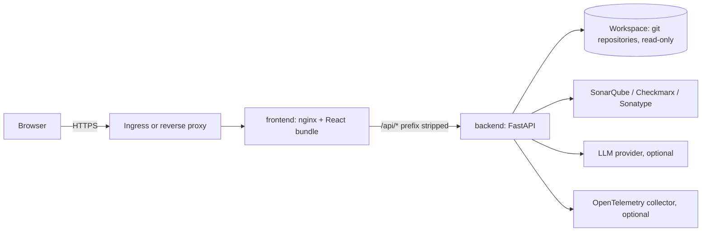

# Architecture

## Overview

USERSTORYAI has two deployable parts: a Python backend that analyses repositories and serves a JSON API, and a React single-page app that renders the dashboards. In containers, nginx serves the app and proxies `/api/` to the backend.

## Backend layers

The backend is organised in layers. Dependencies point inward.

| Layer | Responsibility |
| --- | --- |
| `api` | HTTP routes, request and response models, authentication dependencies |
| `core` | Cross-cutting services: RBAC (`core/security/rbac.py`), LLM provider abstraction (`core/llm`) |
| `domain` | Models such as `MonitorMode` and change and finding types. No I/O |
| `services` | Use cases: analysis, monitoring, repository registry, gates, exports |
| `infrastructure` | Git access (GitPython, run through the git CLI with timeouts), filesystem scanning, in-memory stores |
| `integrations` | Clients for SonarQube, Checkmarx, Sonatype, and LLM providers |
| `mcp` | MCP-style JSON-RPC endpoint (`POST /mcp`) that exposes analysis tools |

`app/container.py` wires dependencies with `dependency-injector`. `app/main.py` exposes `app = create_app()`.

## Frontend structure

- `src/App.tsx`: providers (React Query, app state), the router, and the layout shell. Each page is loaded lazily.
- `src/api/`: typed API client with `ApiError`, API key storage, and React Query hooks. Live refresh uses polling with a 15-second interval.
- `src/lib/`: pure logic for gates, risk classification, graph layout, and exporters. Exporters load `exceljs`, `jspdf`, and `jspdf-autotable` on demand to keep the initial bundle small.
- `src/components/`: shared UI (ShadCN-style primitives, charts with recharts, export menu).
- `src/pages/`: one component per screen.

Unit tests cover the pure logic in `src/lib` and the API client (`vitest`, jsdom).

## Request flow

1. The browser calls `/api/<path>` on the same origin.
2. In development, Vite proxies the request to `VITE_BACKEND_PROXY_TARGET`. In containers, nginx proxies it to `http://backend:8000/`. Both strip the `/api` prefix.
3. The backend checks `X-API-Key` when `AUTH_ENABLED=true`, then applies the role's permissions.
4. The route calls a service, which reads the workspace through the infrastructure layer and returns a JSON result.
5. The UI caches results in React Query and refreshes them on a timer.

## Real-time updates

Updates use polling, not push. There are no SSE or WebSocket endpoints. This keeps the proxy configuration simple but adds up to one polling interval of latency.

## State and scaling

Event history, analysis history, and monitor state are held in process memory, bounded by `EVENT_HISTORY_SIZE` and `ANALYSIS_HISTORY_SIZE`. This is why the backend runs as a single replica. Moving this state to a shared store (for example Redis or PostgreSQL) would allow horizontal scaling.

## Security controls

- RBAC with three roles: `VIEWER`, `ANALYST`, `ADMIN`. Keys come from `API_KEYS`.
- The workspace is mounted read-only. Git subprocesses run with `GIT_TERMINAL_PROMPT=0`, stdin closed, and a timeout.
- Containers run as non-root with read-only root filesystems and all Linux capabilities dropped.
- nginx sends a Content Security Policy, `X-Frame-Options: DENY`, `nosniff`, and a referrer policy. `index.html` is not cached, and hashed assets are cached for one year.

## Known limitations

- **Polling only.** Changes appear after the next poll, not immediately.
- **One backend replica.** In-memory state cannot be shared between replicas.
- **No AST or dependency-graph API.** The backend exposes no AST or dependency-graph endpoint. The dependency-map and AST pages use shared-tag and file-level views.
- **Unverified integrations.** The Checkmarx and Sonatype contracts, and the `generative_engine` LLM provider contract, have not been tested against live services.
- **Unverified container runtime.** The Python 3.12 image and the nginx CSP have not been built or run in this environment.
- **Read-only workspace.** Git operations are assumed to work on a read-only mount. This is not verified.
- **Narrative generation depends on the configured LLM.** With `LLM_PROVIDER=none`, summaries are rule-based.
